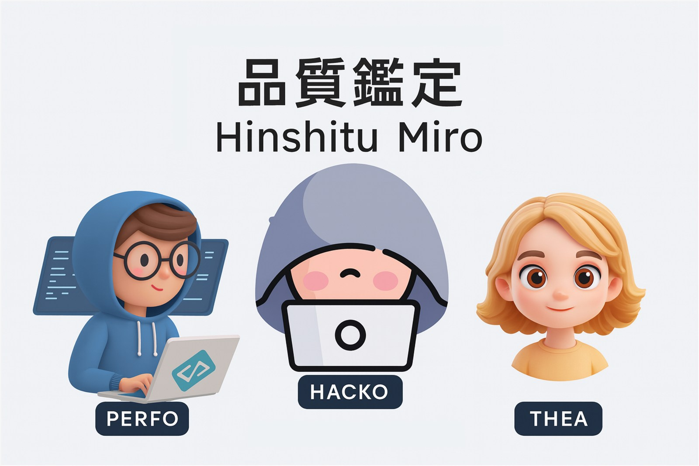
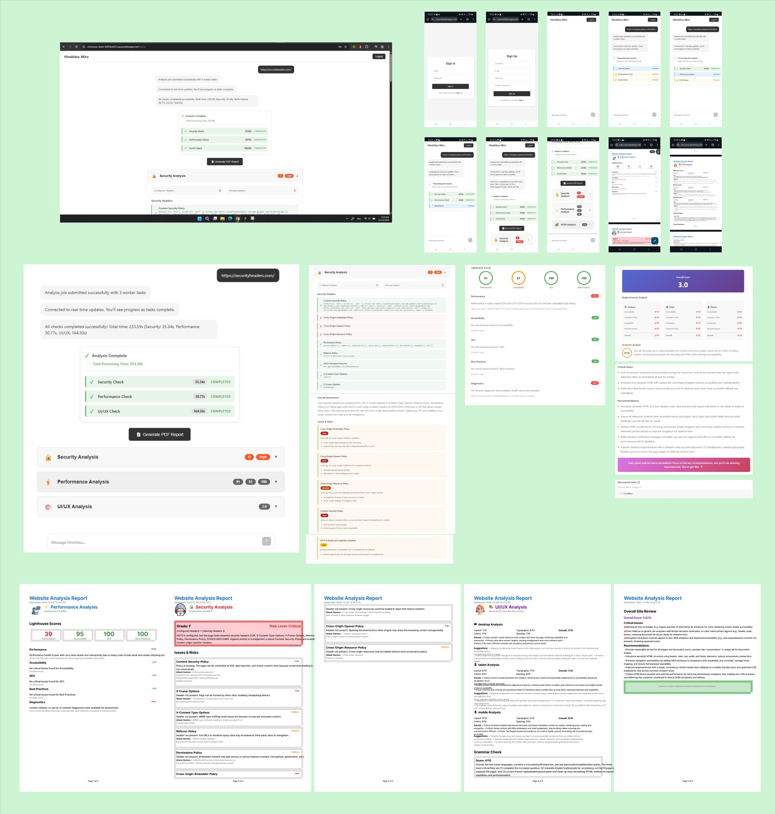

<p align="center"></p>

<h1 align="center">Hinshitsu Miro</h1>

<p align="center"><b>AI-powered website quality analyzer: one URL in, a security, performance and UI/UX audit out.</b></p>

<p align="center">
  
  
  
  
  
</p>

---

**Hinshitsu** (品質, Japanese for *quality*) is a cloud-based website quality analyzer. You submit a URL, and three independent analysis services audit the site in parallel for **security**, **performance**, and **UI/UX**. Results stream back to the dashboard in real time, and you can export everything as a PDF report.

Each analysis combines automated tooling (HTTP header inspection, Google Lighthouse, Playwright screenshots) with Azure OpenAI, which turns raw data into readable findings, scores, and prioritized recommendations.

## Screenshots

<p align="center"></p>

From top to bottom: the desktop dashboard with live task progress, the mobile flow (sign in, sign up, analysis, PDF report), the detailed security / performance / UI/UX results, and the generated PDF report.

---

## Features

- **Security audit**: checks 9 critical HTTP security headers (HSTS, CSP, X-Frame-Options, X-Content-Type-Options, Referrer-Policy, Permissions-Policy, COEP, COOP, CORP). AI analysis returns a grade, risk level, issues with possible attack vectors, and prioritized fixes with implementation snippets.
- **Performance audit**: runs Lighthouse (Performance, Accessibility, SEO, Best Practices), extracts Core Web Vitals (LCP, CLS, FCP, TBT) and top opportunities, then compresses the report into a compact "TOON" summary before sending it to the AI for per-category analysis.
- **UI/UX audit**: captures screenshots at desktop (1920×1080), tablet (768×1024) and mobile (375×667) sizes, then runs three AI checks in parallel: visual design review (layout, colors, typography, spacing), grammar and spelling check of page text, and a DOM-based review (semantic HTML, accessibility, navigation). It also lists the page's links.
- **Real-time progress**: SignalR pushes task progress and job completion events to the browser.
- **Fault tolerant jobs**: a job is marked `Completed` if at least one of the three checks succeeds, and `Failed` only if all three fail.
- **PDF reports**: generated with QuestPDF, stored in Azure Blob Storage, and shared via a time-limited (7-day) SAS link. Each section is presented by a mascot: *Perfobot* (performance), *Hackobot* (security) and *Thea* (UI/UX).
- **Accounts**: sign-up with email verification code (sent through Brevo), login with JWT (24h tokens).

---

## Architecture

<!-- Architecture diagram: export it from Figma as docs/architecture.png, then uncomment the next line -->
<!--  -->

The front end, main API and worker run on Azure (Windows App Services and Static Web Apps). The Security service runs on Azure App Service, while the Performance and UI/UX services run as Linux containers built from Docker Hub images. All components share Azure Storage (blob containers and the three queues), and every deployment is driven from GitHub.

Simplified view:

```
┌────────────────────┐        ┌──────────────────────────┐
│  Angular 20 Web App│ ─HTTP─▶│  HinshitsuWebApis        │──▶ MongoDB (users, jobs)
│  (Static Web Apps) │◀SignalR│  ASP.NET Core 8 API      │
└────────────────────┘        └────────────┬─────────────┘
                                           │ enqueue 3 messages
                                           ▼
                        Azure Storage Queues
              security-checks │ performance-checks │ uiux-checks
                                           │
                                           ▼
                              ┌──────────────────────────┐
                              │  HinshitsuWorker         │──▶ MongoDB (job status)
                              │  .NET 9 background worker│──▶ Blob Storage (results)
                              └───┬──────────┬──────────┬┘──▶ API notifications
                                  │ POST     │ POST     │ POST
                                  ▼          ▼          ▼
                          Security      PerfoCheck   VisualCheck
                          (.NET 8)      (Node +      (Node +
                                        Lighthouse)  Playwright)
                                  └──────────┴──────────┘
                                         Azure OpenAI
```

### Request flow

1. The user submits a URL from the dashboard (`POST /api/Analysis/submit`).
2. The API creates an `AnalysisJob` in MongoDB and pushes one message to each of the three queues.
3. The worker polls the queues, calls the matching microservice (with timeout and exponential-backoff retries via Polly), and saves each result to Blob Storage at `analysis-results/{userId}_{jobId}/{taskType}.json`.
4. After each task, the worker updates the job in MongoDB and notifies the API, which broadcasts `TaskProgress` / `JobCompleted` events over SignalR to the job's and user's groups.
5. When the job is done, the dashboard fetches the summarized results and can request a PDF report.

---

## Repository structure

| Folder | Component | Stack |
|---|---|---|
| `HinshitsuWebApp/hinshitsu-web` | Front end: login, sign-up, email verification, dashboard, results view | Angular 20, `@microsoft/signalr` |
| `HinshitsuService/HinshitsuWebApis` | Main API: auth, job management, SignalR hub, results summary, PDF reports | ASP.NET Core 8, MongoDB, Azure Storage, QuestPDF, Brevo |
| `HinshitsuWorker` | Queue consumer that orchestrates the three checks | .NET 9 Worker Service, Polly, Application Insights |
| `SecurityProject` | Security headers analyzer (API, services and models projects) | ASP.NET Core 8, Azure OpenAI |
| `PerfoCheckProject` | Performance analyzer | Node 22, Express, Lighthouse, chrome-launcher |
| `VisualCheckProject` | UI/UX analyzer | Node 22, Express, Playwright |
| `.github/workflows` | CI/CD pipelines to Azure | GitHub Actions |

---

## API reference

### Main API (`HinshitsuWebApis`)

| Method | Endpoint | Auth | Description |
|---|---|---|---|
| POST | `/api/Auth/signup` | – | Create an account and send a 6-digit verification code |
| POST | `/api/Auth/verify` | – | Verify email with the code |
| POST | `/api/Auth/login` | – | Returns a JWT |
| POST | `/api/Analysis/submit` | JWT | Start an analysis: `{ "url": "https://..." }` |
| GET | `/api/Analysis/{jobId}` | JWT | Job status and per-task results |
| GET | `/api/Analysis/{jobId}/results` | JWT | Summarized results for the dashboard |
| POST | `/api/Analysis/{jobId}/generate-report` | JWT | Generate the PDF and return `{ pdfUrl }` |
| POST | `/api/Notifications/task-progress` | – | Called by the worker |
| POST | `/api/Notifications/job-completion` | – | Called by the worker |
| WS | `/hubs/notifications` | – | SignalR hub (`JoinJobGroup`, `JoinUserGroup`, …) |

Swagger UI is available at `/swagger`.

### Analysis microservices

All three accept `POST` with `{ "url": "https://..." }`.

| Service | Endpoint | Default port | Health |
|---|---|---|---|
| Security | `/api/HinshitsuSecurity/analyze` | from launch settings | `/health` |
| PerfoCheck | `/analyze` | 3000 | `/` |
| VisualCheck | `/analyze` | 4000 | `/`, `/health` |

---

## Getting started

### Prerequisites

- .NET SDK 8 and 9
- Node.js 20+ (22 recommended) and Angular CLI
- Chromium (needed by Lighthouse and Playwright; the Dockerfiles install it)
- A MongoDB database
- An Azure Storage account (queues and blobs), or Azurite for local development
- An Azure OpenAI deployment
- A Brevo account for verification emails

### Configuration

Secret files are git-ignored, so you need to create them yourself.

**`HinshitsuService/HinshitsuWebApis/appsettings.json`**

```json
{
  "MongoSettings": {
    "ConnectionString": "mongodb://...",
    "DatabaseName": "Hinshitsu",
    "UsersCollection": "Users",
    "TasksCollection": "Tasks"
  },
  "AzureStorage": { "ConnectionString": "..." },
  "Jwt": { "Key": "<long random secret>", "Issuer": "...", "Audience": "..." },
  "Brevo": { "ApiKey": "...", "FromEmail": "...", "FromName": "Hinshitsu" }
}
```

**`HinshitsuWorker/appsettings.json`**

```json
{
  "AzureStorage": { "ConnectionString": "..." },
  "MongoSettings": { "ConnectionString": "...", "DatabaseName": "Hinshitsu" },
  "ServiceSettings": { "BaseUrl": "https://<main-api-host>" },
  "Microservices": {
    "SecurityCheckUrl": "https://<security-host>/api/HinshitsuSecurity/analyze",
    "PerformanceCheckUrl": "https://<perf-host>/analyze",
    "UiUxCheckUrl": "https://<visual-host>/analyze"
  },
  "HttpClientSettings": { "TimeoutSeconds": 1000, "RetryCount": 3, "RetryDelaySeconds": 2 },
  "ApplicationInsights": { "ConnectionString": "..." }
}
```

**`SecurityProject/HinshitsuSecurity/appsettings.json`**

```json
{
  "AzureOpenAI": {
    "ApiKey": "...",
    "Endpoint": "https://<resource>.openai.azure.com/",
    "Deployment": "<deployment-name>",
    "ApiVersion": "2024-06-01",
    "TimeoutSeconds": 60,
    "Temperature": 0.2
  }
}
```

**`PerfoCheckProject/.env`** and **`VisualCheckProject/.env`**

```env
AZURE_OPENAI_KEY=...
AZURE_OPENAI_ENDPOINT=https://<resource>.openai.azure.com/
AZURE_GPT_DEPLOYMENT=<deployment-name>
AZURE_OPENAI_API_VERSION=2024-02-15-preview
PORT=3000            # 4000 for VisualCheck
```

**Front end**: set `apiUrl` and `hubUrl` in `HinshitsuWebApp/hinshitsu-web/src/environments/environment*.ts`.

### Running locally

```bash
# 1. Main API
cd HinshitsuService/HinshitsuWebApis && dotnet run

# 2. Security service
cd SecurityProject/HinshitsuSecurity && dotnet run

# 3. Performance service
cd PerfoCheckProject && npm install && npm start

# 4. UI/UX service
cd VisualCheckProject && npm install && npm start

# 5. Worker
cd HinshitsuWorker && dotnet run

# 6. Front end
cd HinshitsuWebApp/hinshitsu-web && npm install && npm start   # http://localhost:4200
```

The Node services can also run in Docker:

```bash
docker build -t hinshitsu-perf PerfoCheckProject && docker run -p 3000:3000 --env-file PerfoCheckProject/.env hinshitsu-perf
docker build -t hinshitsu-visual VisualCheckProject && docker run -p 4000:4000 --env-file VisualCheckProject/.env hinshitsu-visual
```

> Note: `VisualCheckProject` launches Chromium from `/usr/bin/chromium`. On a machine without it at that path, update `executablePath` in `services/screenshotService.js`.

---

## Deployment

Every push to `main` triggers GitHub Actions workflows that deploy to Azure:

| Workflow | Target |
|---|---|
| `azure-static-web-apps-…yml` | Angular app → Azure Static Web Apps |
| `main_hinshitsu-web-apis.yml` | Main API → Azure Web App `hinshitsu-web-apis` |
| `main_hinshitsu-worker.yml` | Worker → continuous WebJob on `hinshitsu-worker` |
| `main_hinshitsumiroappsvc.yml` | Security service → Azure Web App `HinshitsuMiroAppSvc` |
| `main_hinshitsumiroperfcheckappsvc.yml` | Performance service → Azure Web App `HinshitsuMiroPerfCheckAppSvc` |

The Performance and UI/UX services are also published as Docker images on Docker Hub (`mirojlassi/performance-checker` and `mirojlassi/visualcheck-app`) and run as Linux containers. The UI/UX service has no GitHub workflow; it is deployed from its Docker image.

---

## Tech stack

- **Front end:** Angular 20, TypeScript, RxJS, SignalR client
- **Back end:** ASP.NET Core 8, .NET 9 Worker Service, SignalR, JWT, Polly, QuestPDF
- **Analysis:** Google Lighthouse, Playwright, Azure OpenAI
- **Data & infra:** MongoDB, Azure Storage Queues, Azure Blob Storage, Azure App Service, Azure Static Web Apps, Application Insights, Brevo, Docker, GitHub Actions

---

## Author

**Miro Jlassi** · [GitHub](https://github.com/MiroJlassi)
